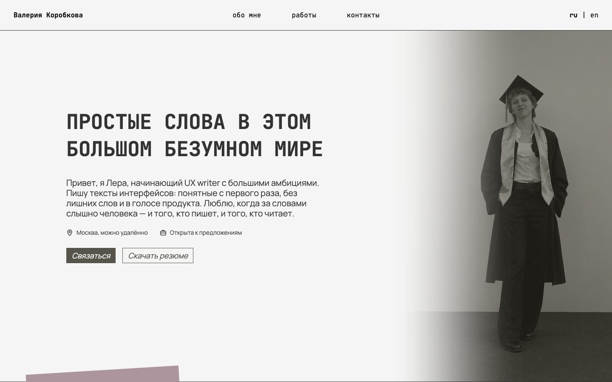

# ✦ UX writer portfolio

**⊹ Открыть · Open it:** [vvallll.github.io/ux-writer-portfolio](https://vvallll.github.io/ux-writer-portfolio/)

### ⊹ О портфолио

Портфолио Валерии Коробковой, UX writer: тексты интерфейсов, редактура и локализация. Сайт на русском и английском. ⋆｡°✩

- ✦ **no commas** · приложение для личных записей: редактура английских текстов, перевод на русский, словарь продукта
- ✦ **Keepsake** · приложение для организации вечеринок: тексты интерфейса, структура приложения, дизайн экранов
- ✦ **Челлендж** · ежедневные задания по UX-письму: от локальных задач до анализа поведения пользователей

### ⊹ About

Valeria Korobkova’s UX writer portfolio: interface copy, editing and localization. The site is in Russian and English. ⋆｡°✩

- ✦ **no commas** · an app for personal notes: editing the English copy, translation into Russian, product glossary
- ✦ **Keepsake** · an app for planning parties: interface copy, app structure, screen design
- ✦ **Challenge** · daily UX writing tasks: from small tasks to in-depth analysis of user behavior
